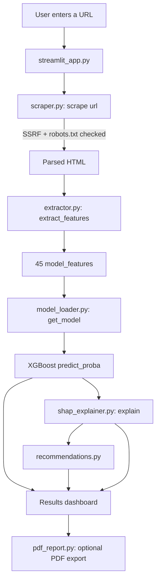
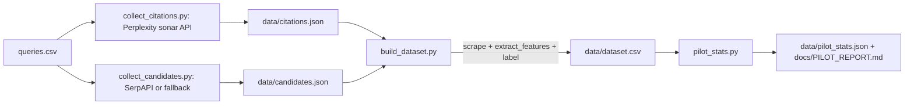
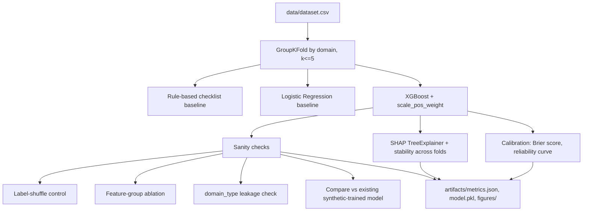

# UNDERSTANDING.md — Module-by-Module Walkthrough

Written for a reader who has never seen this code. Every claim here is
checked against the actual source in this repo (branch `final-review`) —
see `docs/AUDIT.md` for the full audit this is built on. Nothing below is
a hand-typed guess about behavior.

## System overview

Citelytics takes a webpage URL, scrapes it, extracts ~45 numeric features
describing its content/structure/schema/local-business signals, feeds
those features to a trained XGBoost classifier, and explains the resulting
probability with SHAP. There are two parallel deployments of the same
backend logic: a Streamlit app (`streamlit_app.py`, the one actually
launched by `run_streamlit.bat`) and a FastAPI + React stack
(`citation-predictor/backend` + `citation-predictor/frontend`).

**Important honesty note (see `docs/AUDIT.md` Q1):** the model currently
shipped (`citation-predictor/models/citation_model.pkl`) was trained on a
100% synthetic dataset (`model_loader.py: _generate_demo_data`) whose
label is a hand-written linear formula of the *same* features the model
is scored on. Any accuracy number from that pipeline is circular. The real
pilot data pipeline (`pipeline/`) exists to replace this with real
Perplexity-citation-derived data; that pilot has now been run end-to-end
at the full 200-query scale (data collected manually, not via the paid
`PERPLEXITY_API_KEY` — see `STATUS.md`), producing 390 usable real rows
(118 cited / 272 not) and real cross-validated metrics in
`artifacts/metrics.json` (XGBoost ROC-AUC 0.64 ± 0.12, pooled across 10
repeated GroupKFold splits; logistic regression is numerically comparable
at 0.69 ± 0.08 — see `docs/VIVA_QA.md`, "Evaluation" section, for the full
breakdown). Scored on this real data, the original synthetic-trained
model drops to AUC 0.49 — essentially chance — the clearest evidence that
synthetic-label training doesn't transfer to reality. Anywhere a number
isn't backed by one of these measured runs, this document still says
**NOT YET MEASURED**.

## Module: `citation-predictor/backend/scraping/scraper.py`

- **Purpose:** fetch a URL safely and return parsed HTML.
- **Key function:** `scrape(url) -> {"soup", "raw_html", "status_code", "final_url"}`.
- **Inputs:** a URL string. **Outputs:** a BeautifulSoup tree + metadata, or
  raises `ScrapingError`.
- **Design choices and why:**
  - *SSRF guard (`_check_ssrf`)* resolves the hostname and rejects
    localhost/private-range/cloud-metadata IPs **before** connecting, and
    is re-run on every redirect hop (`MAX_REDIRECTS = 5`) — because
    `requests`' own `allow_redirects=True` does independent DNS resolution
    per hop and would otherwise let a malicious URL 302 its way past the
    initial check.
  - *robots.txt (`_check_robots_txt`)*, cached per host with
    `urllib.robotparser`, so a disallowed path is refused before fetching
    — required by our stated scraping ethics (`docs/ETHICS_AND_LIMITS.md`).
  - *Timeout (15s) and 5 MB size cap* so one slow/huge page can't stall or
    balloon a batch pipeline run.
  - **Why `requests` + manual redirect loop instead of a headless
    browser (Selenium/Playwright)?** Far lighter weight, no JS execution
    needed for this feature set (structure/text/schema are present in
    server-rendered HTML for the business sites we target), and much
    easier to keep deterministic/testable for a student project running
    under exam time pressure.

## Module: `citation-predictor/backend/features/extractor.py`

- **Purpose:** turn a parsed page into ~45 numeric features.
- **Key function:** `extract_features(soup, url) -> {"model_features": {...}, "content": {...}, "structure": {...}, "schema": {...}, "local_business": {...}, "derived": {...}}`.
- **Four feature groups:**
  1. **Content** — word/sentence/paragraph counts, factual-density signals
     (numbers, percentages, dates, citation-reference patterns like
     `[1]`/"et al."), link/image/list/table/emphasis counts.
  2. **Structure** — heading counts/depth, a hand-tuned
     `heading_hierarchy_score` (`h1_present*0.5 + h2_present*0.3 +
     h3_present*0.2`), section count (`max(h2_count, 1)`).
  3. **Schema** — JSON-LD / microdata `@type` detection
     (`_extract_schema_features`): `schema_present`,
     `local_business_schema`, `faq_schema`, etc.
  4. **Local business** — regex-detected phone/address/hours/rating
     mentions in the visible text.
  - Three **derived composite scores** (`macro_structure_score`,
    `meso_structure_score`, `micro_structure_score`) are weighted
    combinations of the raw features above — see `docs/AUDIT.md` Q3 for why
    this is a double-counting/leakage risk when these composites are fed
    back into the synthetic label formula.
- **Why regex + BeautifulSoup instead of an LLM-based extractor?**
  Deterministic, free, fast, and auditable line-by-line in a viva — a
  panel can ask "why is this number X" and get an exact formula, not a
  black-box LLM's guess.

## Module: `citation-predictor/backend/models/model_loader.py`

- **Purpose:** load a pretrained XGBoost pipeline, or (if none exists)
  generate synthetic training data and train one in-process.
- **Key functions:** `load_or_train_model()`, `_generate_demo_data()`,
  `_train()`, `get_model()`.
- **`FEATURE_COLUMNS`** — the fixed, ordered list of 45 column names every
  other module must agree on (see `tests/test_feature_model_match.py`,
  which checks the extractor actually produces every one of these columns
  and that the app feeds them to the model in this exact order).
- **The synthetic-data problem (restated plainly):** `_generate_demo_data`
  draws all 45 features from `numpy` random distributions, then computes
  `label = 1 if (factual_density*8 + schema_present*2 + ... + noise) > median else 0`
  — a formula built from the same columns the model is trained on. XGBoost
  therefore learns to re-derive a known linear formula, which is a
  different (and much easier) problem than predicting real citation
  behavior. This is why the pilot pipeline (`pipeline/`) exists: to replace
  this with labels derived from actual Perplexity citations.

## Module: `citation-predictor/backend/explainability/shap_explainer.py`

- **Purpose:** explain one prediction.
- **Key function:** `explain(model, feat_cols, feature_values) -> {"shap_values", "top_positive", "top_negative", "base_value"}`.
- Uses `shap.TreeExplainer(model)` — the correct, exact (not approximate)
  SHAP method for tree ensembles like XGBoost, computing each feature's
  marginal contribution to the predicted log-odds for *that one row*.
- **What this explains, and what it does NOT:** it explains why *our
  XGBoost classifier* produced a given probability from the 45 input
  features. It says nothing about how Perplexity/ChatGPT/Claude actually
  decided what to cite — we never have access to that model's internals.

## Module: `pipeline/` (real-data collection, run at full scale — see `docs/DATA_CARD.md`)

- `queries.csv` — 200 fixed local-business queries across 4 categories
  (50 each).
- `collect_citations.py` — calls Perplexity's `sonar` model per query,
  extracts cited URLs from whichever response fields are actually present
  (`citations` and/or `search_results`), caches raw JSON, enforces
  `--max-calls`/`--dry-run`/retries (see `docs/ETHICS_AND_LIMITS.md`).
- `collect_candidates.py` — organic results via SerpAPI, or a documented
  fallback to the Perplexity response's own `search_results`.
- `build_dataset.py` — scrapes the cited ∪ candidate URL pool through the
  same `scrape()`/`extract_features()` used by the live app (so there's
  no train/serve feature mismatch), labels by canonical-URL match
  (`docs/DATA_CARD.md`), flags duplicate-template pages and a transparent
  `domain_type` (business/directory/social/news).
- `evaluate.py` — GroupKFold-by-domain cross-validation of three models
  (rule-based checklist, logistic regression, XGBoost), a label-shuffle
  negative control, feature-group ablation, a domain_type leakage check, a
  head-to-head against the existing synthetic-trained model, SHAP
  stability across folds, and calibration (Brier score + reliability
  curve) — writing everything to `artifacts/metrics.json`, never hand-typed.

## (a) Worked end-to-end example

Tiny HTML snippet:

```html
<html><body>
<h1>Apex Gym</h1>
<p>Apex Gym has 5 trainers.</p>
</body></html>
```

Tracing `extract_features()` by hand against the actual formulas in
`extractor.py` (bs4 wasn't installed in this sandbox to execute it live,
so these are hand-computed from the real source — anyone can re-run this
exact snippet through `extract_features()` to check):

| Step | Value | From |
|---|---|---|
| `_text(soup)` | `"Apex Gym Apex Gym has 5 trainers."` | `soup.get_text(separator=" ", strip=True)` |
| `word_count` | 7 | `len(text.split())` |
| `sentence_count` | 1 | one `.`-terminated clause ≥2 words |
| `paragraph_count` | 1 | one `<p>` |
| `avg_sentence_length` | 7.0 | 7 words / 1 sentence |
| `avg_paragraph_length` | 5.0 | "Apex Gym has 5 trainers." = 5 words |
| `number_count` | 1 | regex matches "5" |
| `h1_count` | 1, `h2_count` 0 | tag counts |
| `heading_hierarchy_score` | 0.5 | `h1_ok(1)*0.5 + h2_ok(0)*0.3 + h3(0)*0.2` |
| `section_count` | 1 | `max(h2_count, 1)` |
| `schema_present` | 0 | no `<script type="application/ld+json">` |
| `factual_density` | 0.1429 | `(1*1.0) / 7`, capped at 1.0 |
| `format_diversity` | 0.0 | none of the 7 format signals present |
| `macro_structure_score` | 0.3428 | `(1 + 0 + 0.2 + 0.014 + 0.5) / 5` |
| `meso_structure_score` | 0.0625 | `(0.25 + 0 + 0 + 0) / 4` |
| `micro_structure_score` | 0.3472 | `(0 + 1.0 + 0 + 0.3889) / 4` |

**Model probability:** NOT YET RUN — requires a trained model loaded in a
live Python process with the full dependency stack installed; the formula
is `model.predict_proba(row)[0, 1]` where `row` is exactly these 45 values
in `FEATURE_COLUMNS` order.

**SHAP breakdown (conceptual, since we can't run the model here):** SHAP
would decompose `log-odds(probability) = base_value + Σ shap_value(feature)`
across all 45 features for this one row. Given this page has almost no
content (7 words, no schema, no FAQ), we'd expect large *negative*
contributions from `word_count`, `schema_present`, and `format_diversity`
pulling the prediction well below the base rate — see `docs/WHITEBOARD.md`
exercise 5 for a fully-worked numeric example of this additive arithmetic.

## (b) Diagrams

### System architecture



### Data-collection flow (`pipeline/`)



### Training / evaluation flow (`pipeline/evaluate.py`)



## (c) Glossary (plain English)

- **Schema / JSON-LD** — a standard way to embed machine-readable facts
  (business name, phone, FAQs) directly in a webpage's HTML, inside a
  `<script type="application/ld+json">` tag, so search/AI systems can read
  structured data instead of guessing from prose.
- **SERP** — Search Engine Results Page; the list of links Google (or
  similar) returns for a query.
- **RAG (Retrieval-Augmented Generation)** — an AI answer system that
  first retrieves relevant documents/pages, then generates an answer
  grounded in them, often citing the sources it used.
- **GEO (Generative Engine Optimization)** — optimizing a webpage so that
  generative AI answer engines (which synthesize an answer and cite only
  1-3 sources, unlike classic 10-blue-links search) are more likely to
  cite it.
- **XGBoost / boosting** — an ensemble machine-learning method that builds
  many small decision trees one after another, where each new tree
  focuses on correcting the previous trees' mistakes; the final prediction
  sums all trees' outputs.
- **SHAP (SHapley Additive exPlanations)** — a method from cooperative
  game theory that fairly splits a prediction's deviation from a baseline
  across each input feature, so you can say exactly how much each feature
  pushed the prediction up or down.
- **ROC-AUC** — Area Under the Receiver Operating Characteristic curve;
  the probability a randomly chosen positive example gets a higher score
  than a randomly chosen negative one. 0.5 = random guessing, 1.0 = perfect.
- **PR-AUC** — Area Under the Precision-Recall curve; like ROC-AUC but
  more informative when the positive class is rare (class imbalance),
  because it doesn't get inflated by a large number of true negatives.
- **GroupKFold** — a cross-validation scheme that keeps every row from the
  same group (here, the same website domain) entirely within one fold, so
  the same site is never used for both training and testing.
- **Leakage** — when information that wouldn't be available at real
  prediction time (or that's circularly derived from the label itself)
  sneaks into the training features, making evaluation metrics look better
  than they really are.
- **Calibration** — whether a predicted probability (e.g. "70% likely")
  actually corresponds to the true frequency of the outcome (70% of such
  predictions turning out positive). A model can rank cases correctly
  (good AUC) while still being poorly calibrated.
- **Class imbalance** — when one outcome (e.g. "not cited") is far more
  common than the other ("cited") in the dataset, which can bias both
  training and naive accuracy metrics toward the majority class.
